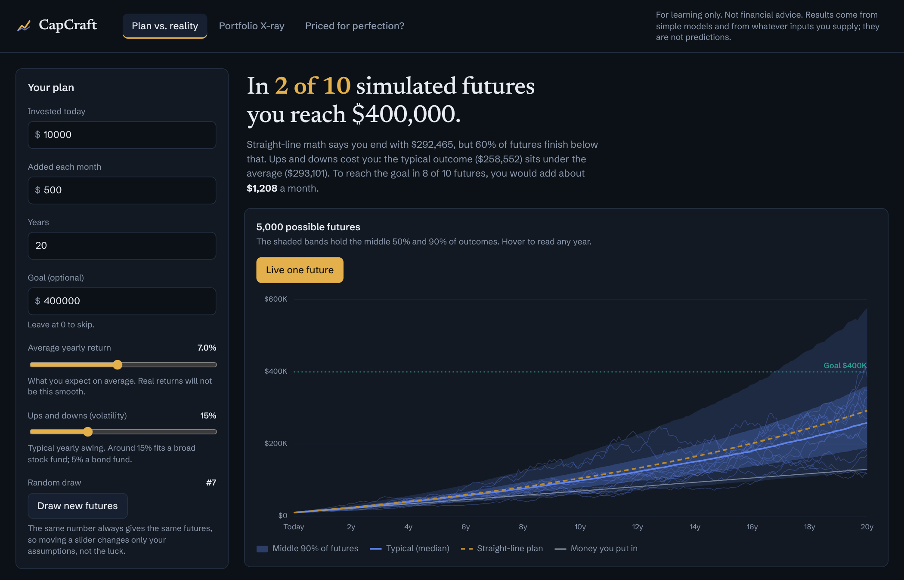
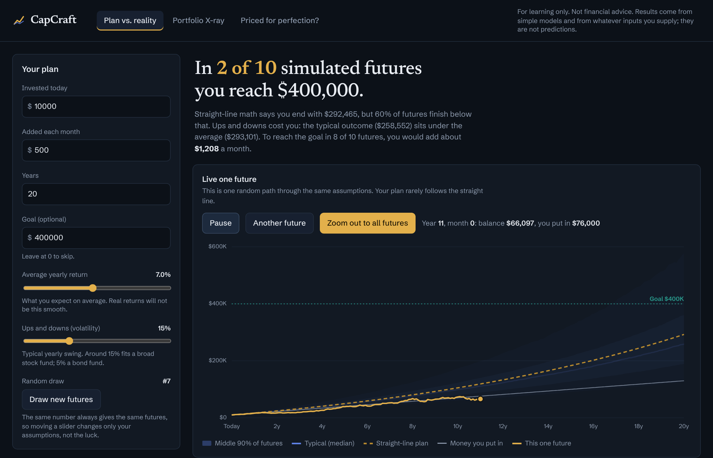
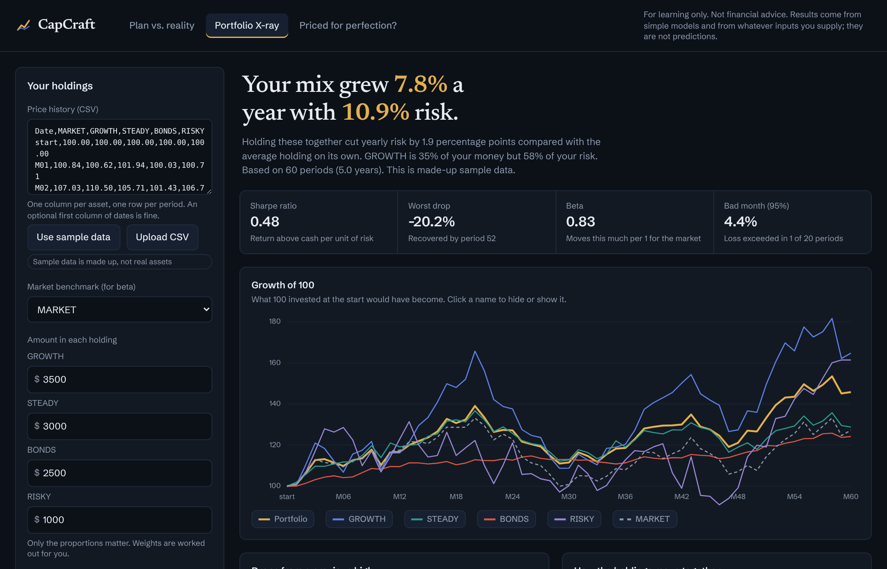
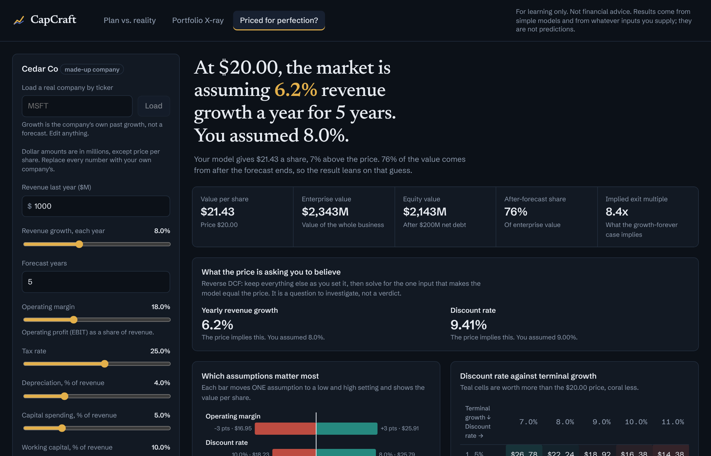

# CapCraft

Test a savings plan against thousands of possible futures, X-ray a portfolio, and check what a stock price assumes.
For learning only. Not financial advice.

CapCraft has three tools in one dark-themed app:

| Tab | The question | What it uses |
|---|---|---|
| Plan vs. reality | Will my plan work, and what would make it likely to? | Monte Carlo (geometric Brownian motion), exact solve for the monthly amount needed |
| Portfolio X-ray | What is my mix really doing? | Price CSV, risk contributions, Sharpe/Sortino/beta, drawdowns, sampled efficient frontier |
| Priced for perfection? | What does this price assume? | DCF, reverse DCF, sensitivity grid, tornado |

The sample portfolio and "Cedar Co" are made up. Nothing here is real market data.

## Layout

    capcraft/       tested Python library (numpy only): tvm, risk_return, risk_metrics, portfolio,
                    monte_carlo, dcf, sensitivity, data, sample_data
    capcraft_api/   FastAPI layer (schemas, service, main); limits, readable 422 errors, NaN-free JSON
    web/            React + TypeScript (Vite); API types generated from the API's OpenAPI file
    tests/          library and API tests (303)
    docs/           screenshots and the demo script
    examples/       worked examples, run as scripts

## Run it

    pip install -e ".[dev]"
    pytest                                   # library and API tests
    uvicorn capcraft_api.main:app --port 8000

    cd web
    npm install
    npm run dev                              # http://localhost:5173, proxies /api to port 8000

When the API changes, regenerate the types: export `app.openapi()` to `web/openapi.json`, then
`npx openapi-typescript openapi.json -o src/api/schema.d.ts`.

## Live data (optional)

Set any of these environment variables (see `.env.example`). Each feature switches on only when its setting exists,
and CapCraft works fully without any of them. Keys stay on the server and are never sent to the browser.

| Setting | Turns on | Source |
|---|---|---|
| `CAPCRAFT_SEC_USER_AGENT` | "Load a real company by ticker" on the DCF tab | SEC EDGAR company facts (no key; the SEC asks for a contact string) |
| `ALPHAVANTAGE_API_KEY` | the latest share price for that company | Alpha Vantage (free tier is small; answers are cached 15 minutes) |
| `FRED_API_KEY` | `GET /api/rates`, the 10-year Treasury yield | FRED |

Loaded numbers are history, not forecasts: growth is the company's own past growth, margins are 3-year averages,
and every number lists how it was derived. Banks and insurers do not fit this model and are rejected with a message.

**Before you demo, run `python scripts/check_live.py MSFT` once** with your keys and compare the printed numbers with the
company's 10-K. The adapters are tested against invented fixtures shaped like the services' responses, but they were
written where those services could not be reached, so they have not been verified against the live services.

## Saved real data (works with no keys)

`python scripts/make_snapshot.py MSFT AAPL KO` saves real, SEC-derived assumptions (and the 10-year Treasury yield, if
`FRED_API_KEY` is set) into `data/snapshots/`. Run it once with your keys, check the printed numbers against each
company's 10-K, then commit the folder (no keys inside). With snapshots present, the DCF tab offers those companies as
quick picks even with no network, labelled "saved <date>". A live lookup, when available, always wins; a snapshot only
stands in when live data is unreachable or not set up, never for an unknown ticker or an unsuitable company. Share
prices are deliberately not saved. The folder ships empty: nothing is invented.

## Deploy

One container serves both the API and the built frontend:

    docker build -t capcraft .
    docker run -p 8000:8000 capcraft          # http://localhost:8000

On Render: New > Blueprint, pick this repo (`render.yaml` is included). It runs with no keys; add
`CAPCRAFT_SEC_USER_AGENT`, `ALPHAVANTAGE_API_KEY` and `FRED_API_KEY` in the dashboard only if you want live lookups.
Any host that runs a Dockerfile works (Fly.io, Railway). Set `PORT` if the host requires it.
Set `CAPCRAFT_CORS` only if the frontend is served from a different address. CI (`.github/workflows/ci.yml`) runs the tests, lint and a build.
The Dockerfile has not been built in the environment where this was written, so check the first build.

A demo script is in [docs/DEMO.md](docs/DEMO.md).

## Assumptions and limits

Each tab has a "How this works, and what it leaves out" panel fed by `GET /api/meta`.
In short:

- Plan: monthly returns are lognormal and independent. Mean matches the straight-line math, so the median is lower (volatility drag). No taxes, fees or inflation. Results show their random draw number and are reproducible.
- X-ray: weights are held constant (rebalanced). Risk assumes independent periods. The frontier is sampled at random, so min-risk and best-Sharpe are approximations and describe the past only.
- DCF: terminal value is often most of the value. Sensitivity changes one or two inputs at a time and misses interactions. A reverse DCF is a question, not a verdict.

## How it is tested

Hand-worked numbers and exact identities, statistical checks within standard errors, input-validation cases,
API results compared with direct library calls, and mutation checks (plant a bug, confirm a test fails).
